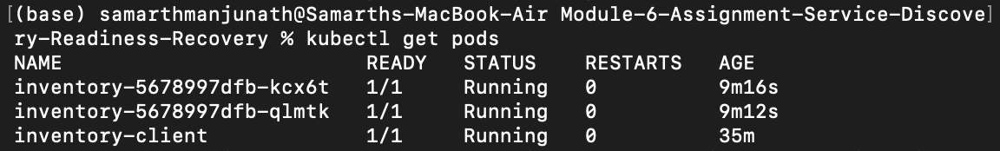
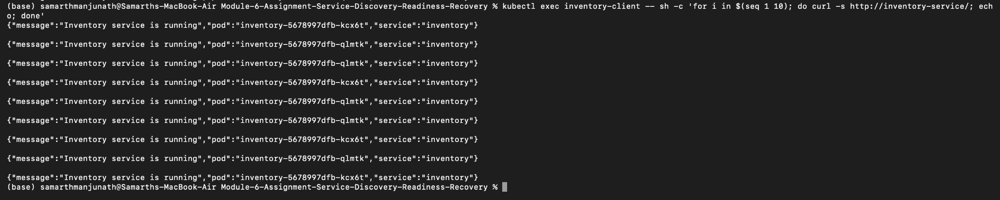
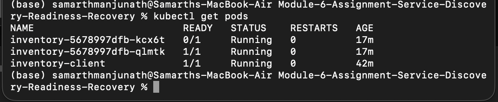
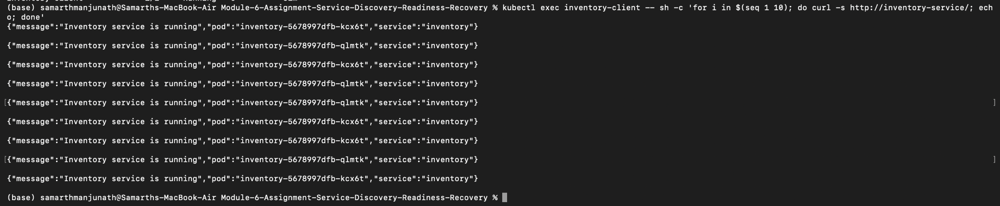
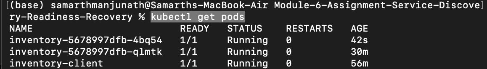
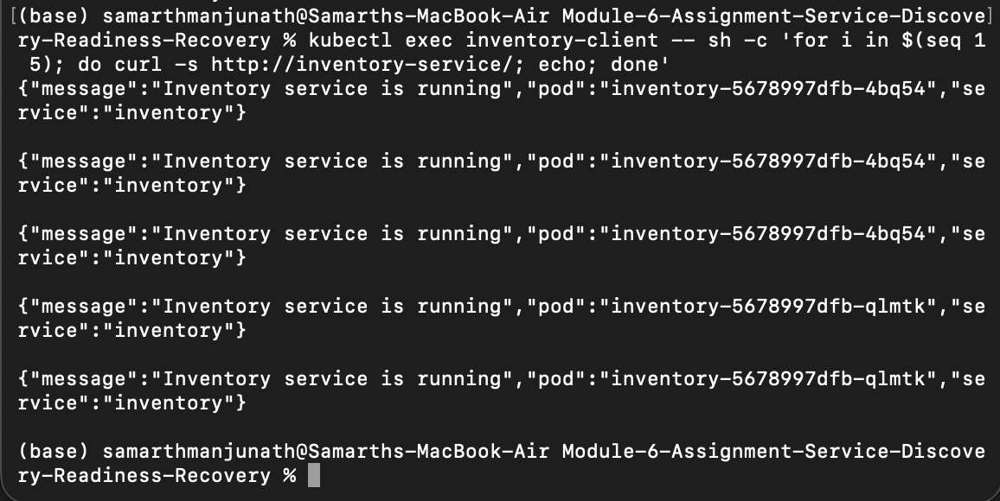
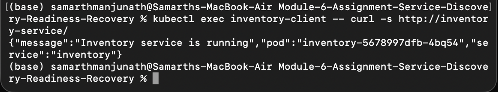

# Module 6 Assignment: Service Discovery, Readiness & Recovery

This project demonstrates Kubernetes **service discovery, readiness probes, traffic routing, and automatic Pod recovery** using a small Inventory application. The application runs as **2 Inventory replicas** behind a stable Kubernetes Service, while a separate client Pod communicates with the application using the Service name instead of individual Pod addresses.

## Architecture

```text
                    Kubernetes Cluster

                    inventory-client
                           |
                           | http://inventory-service/
                           v
                  +-------------------+
                  | inventory-service |
                  |    ClusterIP      |
                  +-------------------+
                     /             \
                    /               \
                   v                 v
          +----------------+  +----------------+
          | Inventory Pod  |  | Inventory Pod  |
          |   Replica 1    |  |   Replica 2    |
          |   Port 5000    |  |   Port 5000    |
          +----------------+  +----------------+
```

The Service exposes port 80 and forwards requests to port 5000 on ready Inventory Pods.

## Project Structure

```text
.
├── app.py
├── Dockerfile
├── requirements.txt
├── README.md
├── k8s/
│   ├── inventory.yaml
│   └── client.yaml
└── evidence/
    ├── screenshot-1-running-pods.png
    ├── screenshot-2-service-discovery.png
    ├── screenshot-3-readiness-failure.png
    ├── screenshot-4a-unready-traffic.png
    ├── screenshot-4b-readiness-recovery.png
    ├── screenshot-5a-pod-replacement.png
    ├── screenshot-5b-recovery-traffic.png
    └── screenshot-5c-service-access.png
```

## 1. Deploy the Application

### Prerequisites

- Docker Desktop
- Kubernetes enabled in Docker Desktop
- `kubectl`

Verify the cluster:

```bash
kubectl get nodes
```

Build the Inventory image using the same tag referenced by the Deployment:

```bash
docker build -t inventory-app:v1 .
```

Deploy the Inventory Deployment, Service, and client:

```bash
kubectl apply -f k8s/inventory.yaml
kubectl apply -f k8s/client.yaml
```

Verify the Pods:

```bash
kubectl get pods
```

### Evidence 1 - Two Inventory replicas and client running



Both Inventory replicas and the client are `1/1 Running`.

## 2. Service Discovery and Multiple Replicas

The client communicates with the application through the stable Kubernetes Service name `inventory-service`:

```bash
kubectl exec inventory-client -- sh -c 'for i in $(seq 1 10); do curl -s http://inventory-service/; echo; done'
```

### Evidence 2 - Requests reach more than one replica



The responses show requests handled by both `inventory-5678997dfb-kcx6t` and `inventory-5678997dfb-qlmtk`. This demonstrates that the client uses the Service name and that Service traffic can reach more than one replica.

## 3. Readiness Test

The Deployment defines an HTTP readiness probe against `/health/ready` on container port 5000. The application also provides `/fail-ready` and `/restore-ready` endpoints to demonstrate readiness changes.

For this run, the first Inventory Pod had IP `10.244.0.10`. Readiness was deliberately disabled with:

```bash
kubectl exec inventory-client -- curl -s -X POST 10.244.0.10:5000/fail-ready
```

After the probe detected the failure:

```bash
kubectl get pods
```

### Evidence 3 - Pod remains running while unready



One Inventory Pod shows `0/1 Running` while the other remains `1/1 Running`. The failed readiness check therefore removes readiness without terminating the Pod.

### Evidence 4A - Unready Pod stops receiving normal traffic

While one replica was unready, requests were sent through the Service again:

```bash
kubectl exec inventory-client -- sh -c 'for i in $(seq 1 10); do curl -s http://inventory-service/; echo; done'
```


All responses came from `inventory-5678997dfb-qlmtk`, the ready replica. The unready Pod stopped receiving normal Service traffic while the ready Pod continued serving requests.

## 4. Readiness Recovery

Readiness was restored on the first Pod with:

```bash
kubectl exec inventory-client -- curl -s -X POST 10.244.0.10:5000/restore-ready
```

After the readiness probe detected recovery, both Pods returned to `1/1 Running`. Requests were then sent through `inventory-service` again.

### Evidence 4B - Restored Pod receives traffic again



Responses again came from both Inventory replicas, demonstrating that a recovered Pod is automatically returned to Service traffic.

## 5. Pod Failure and Recovery

Before the failure test, the two Inventory Pods included:

```text
inventory-5678997dfb-kcx6t
inventory-5678997dfb-qlmtk
```

One Pod was deleted:

```bash
kubectl delete pod inventory-5678997dfb-kcx6t
```

Because the Deployment requires 2 replicas, Kubernetes automatically created a replacement Pod. The replacement was named:

```text
inventory-5678997dfb-4bq54
```

### Evidence 5A - Replacement Pod has a new identity



The post-deletion Pod listing shows `inventory-5678997dfb-4bq54` running alongside the existing `inventory-5678997dfb-qlmtk`. The deleted `...-kcx6t` Pod has been replaced by a Pod with a different identity.

### Evidence 5B - Client continues communicating after replacement



Requests through `http://inventory-service/` continue succeeding after replacement and reach the replacement Pod `...-4bq54` as well as the existing Pod `...-qlmtk`.

### Evidence 5C - Stable Service access



The client continues to use the same `http://inventory-service/` address after the underlying Pod identity changed. The Service definition remains `inventory-service` in `k8s/inventory.yaml`; clients therefore do not need to track individual Pod names or addresses.

## Results Summary

| Requirement | Result |
|---|---|
| Deployment has 2 Inventory replicas | Complete |
| Both Inventory Pods run successfully | Complete |
| Kubernetes Service exposes replicas | Complete |
| Client accesses Inventory using Service name | Complete |
| Requests reach more than one replica | Complete |
| Readiness probe configured | Complete |
| One Pod fails readiness but stays running | Complete |
| Unready Pod stops receiving normal traffic | Complete |
| Ready Pod continues serving requests | Complete |
| Readiness restored and Pod receives traffic again | Complete |
| Inventory Pod manually deleted | Complete |
| Kubernetes creates a replacement Pod | Complete |
| Replacement has a different identity/name | Complete |
| Service name remains unchanged | Complete |
| Client continues communicating through Service | Complete |

## Reflection

A stable Kubernetes Service name is useful because Pods are temporary and their names and IP addresses can change when they fail, restart, or are replaced. Instead of requiring clients to track individual Pods, the client communicates with a stable name such as `inventory-service`. Kubernetes routes Service traffic to Pods that are currently ready and can automatically include replacement or recovered Pods. This allows the application to continue working even as the underlying Pods change.

## Cleanup

```bash
kubectl delete -f k8s/client.yaml
kubectl delete -f k8s/inventory.yaml
```
